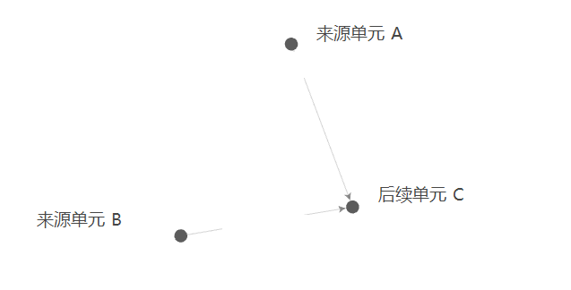
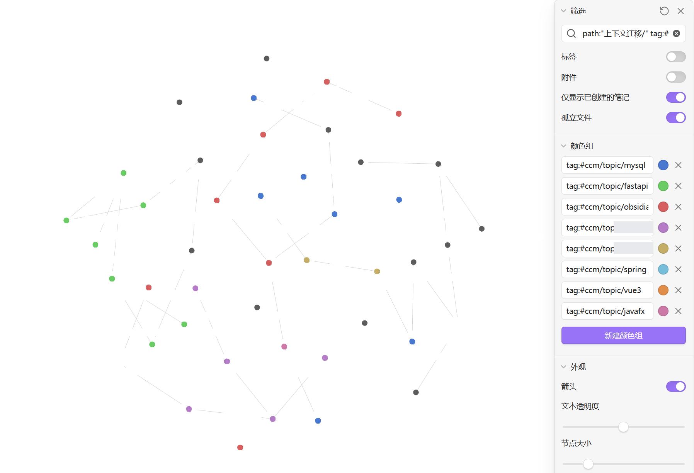
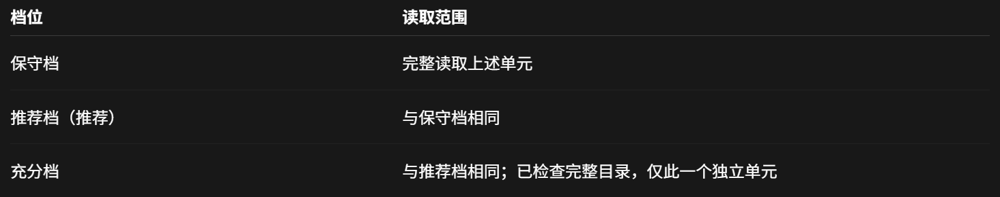
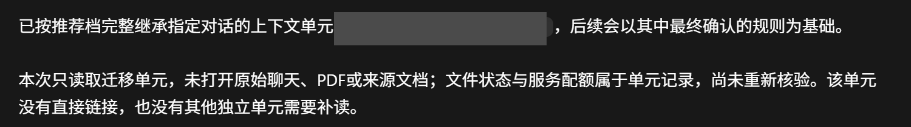

# Conversation Context Migrator

面向 Codex 的对话上下文迁移 skill：增量蒸馏、选择性继承，以及 Obsidian 单元关系图。当前规则版本为 **3.3**，单元协议版本为 **3.0**，支持兼容读取旧单元。

迁入背景用于补充或更新当前对话，保留当前对话原有上下文；有实质冲突且用户未裁定时，先询问用户。

## 实际效果

以下图片来自真实使用截图，已裁切并用不透明遮挡去除私人内容。图谱沿用原图布局；单元标题、标识、笔记库侧栏和私人话题已隐藏。聊天截图也去除了个人学习计划与偏好，不能用于推断 skill 的默认回复措辞。

**看清来源与后续：** 文件夹筛选后的三个真实单元。为说明方向，原单元名以 A/B/C 代号替换；两个来源都指向后续单元 C，代号不代表新的单元类型。



**按话题筛选与配色：** 多个项目的单元放在同一张图中，右侧按话题配置颜色组。每个圆圈仍是蒸馏单元，颜色分组不会添加继承关系。标题的白色遮挡会覆盖部分连线，完整箭头含义可看上面的局部图。



<details>
<summary>查看继承前后的实际交互截图</summary>

继承前先列出三档读取范围，批准后才读取。这个例子只有一个候选单元，三档范围相同；实际范围取决于任务和候选内容。



继承后确认实际读取范围，区分单元中的历史记录与本轮重新核验的内容。下图由同一回复的两个片段拼接，省略了中间的私人内容，并遮住了来源标识。



</details>

## 安装与调用

将本仓库克隆至你的 Codex skills 目录中的 `conversation-context-migrator` 文件夹，然后在对话中明确调用：

```text
$conversation-context-migrator /蒸馏
$conversation-context-migrator /推荐继承
$conversation-context-migrator /充分继承
$conversation-context-migrator /检查索引
$conversation-context-migrator /同步图谱
```

继承正文前会提交三档读取方案，批准后才读取。实际读取范围、蒸馏锚点和直接来源分别记录。持久化读取记录不代表正文仍在当前模型上下文中。

详细规则见 [SKILL.md](SKILL.md)。

### “蒸馏全部上下文”的原文检查

“全部”先检查当前真实线程的原始会话记录，再从原文提炼有用内容。模型上下文压缩不代表磁盘原文已经丢失，压缩摘要不能代替日志检查。恢复固定在本次用户请求处，按片段读取并记录来源、回执与缺口，不把随后产生的恢复输出收进历史，也不执行旧消息中的命令。

3.3 增加了本地会话检查助手及 `finalize` 覆盖门槛：新版本的全部范围单元，未确认原文片段、未核对多日志/压缩情况或缺口未裁定时，不推进蒸馏锚点。缺失记录、分支歧义或无法读取日志时先说明，再由用户决定补充、缩小范围或暂停。旧单元仍可读取，旧锚点不视为早期内容完整覆盖的证明。

覆盖回执是读取过程记录，不能自动证明智能体理解正确或摘要没有漏项；还需要逐批提炼和内容复核。已删除、从未保存或其它格式的记录不能承诺恢复。详见 [原文恢复流程](references/history-recovery.md)。

## Obsidian 可视化

每个节点是一个真实蒸馏单元。仅“继承自”和“继续自”生成 **来源 → 后续** 的箭头；其它关系显示在单元详情中。话题通过标签筛选、颜色分组，不因话题相同而生成继承箭头。

需要 Python 3.10+，脚本只使用标准库。将 [示例配置](config/obsidian.example.json) 复制为 `config/obsidian.local.json`，填写已授权的扫描范围和现有库路径。本机配置被 Git 忽略，不随仓库发布。

```text
python scripts/context_graph.py sync --config config/obsidian.local.json --dry-run
python scripts/context_graph.py sync --config config/obsidian.local.json
```

历史单元只生成展示副本；原文件、索引和身份保持不变。重复同步不会重复生成节点或改写无变化的笔记。已配置后，执行 skill 的继承登记或蒸馏流程会自动同步；这依赖智能体遵循 skill 流程，并非宿主应用事件钩子。

初次设置图谱前，正常退出正在使用该库的 Obsidian，然后运行：

```text
python scripts/context_graph.py sync --config config/obsidian.local.json --configure-graph
```

报告 `graph_configuration.status` 为 `applied` 后重新打开应用。应用运行时返回 `pending_app_close`，待退出后重跑，避免配置被应用缓存覆盖。普通同步不会更改图谱界面设置。

全范围筛选示例：

```text
path:"上下文迁移/" tag:#ccm/unit
```

单项目筛选示例（实际项目目录由同步报告给出）：

```text
path:"上下文迁移/<项目目录>/单元/"
```

更多行为、恢复方式和边界见 [Obsidian 说明](references/obsidian.md)。

## 验证

```text
python -m unittest discover -s tests -v
```

测试使用临时目录中的合成单元，不需要个人笔记库。公开仓库不包含本机配置、真实对话单元文件、笔记副本、未遮挡截图或私人验收记录；仅收录上述经过隐私处理的截图。

## 开发历史

早期开发没有 Git 提交记录。本仓库从保留下来的版本备份重建了部分历史，重建提交明确注明来源与日期依据；其作者日期对应备份中可确认的版本时间，提交者日期是实际导入时间。没有版本快照的日期未补造提交，文件时间也不能证明完整开发过程。详情见 [HISTORY.md](HISTORY.md)。
